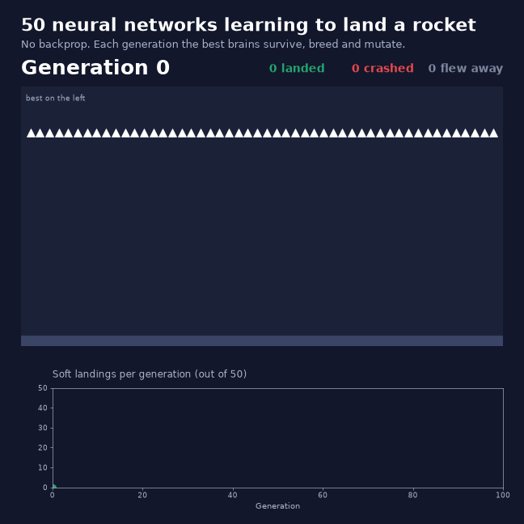
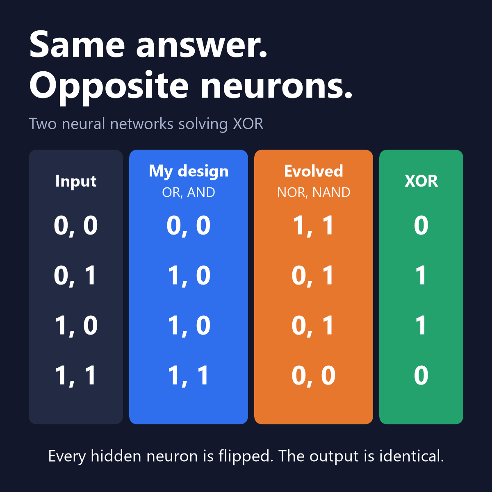

# Machine Learning from Scratch (pure Python)



Every model in this repo is written by hand in plain Python: no NumPy, no scikit-learn, no PyTorch. The math (gradients, backpropagation) is derived on paper first, then implemented and checked numerically. The repo grows one concept at a time, from vector math to a neural network that learns to land a rocket through evolution.

Write-up: [LinkedIn post about the rocket project](https://www.linkedin.com/posts/vasistha-yadav-05a952233_machinelearning-neuralnetworks-geneticalgorithms-ugcPost-7530175719319162880-xuW_/)

## Highlights

**Rockets learning to land (neuroevolution).** 50 rockets per generation, each controlled by a tiny neural network with 9 parameters. No backprop: the best rockets survive, breed and mutate.

| Generation | Soft landings (out of 50) |
|---|---|
| 0 | 0 |
| 20 | 1 |
| 24 | 26 |
| 50 | 37 |
| 100 | 34 |

For the first 20 generations no rocket lands. Then, over generations 20 to 24, soft landings go 1, 3, 7, 15, 26, and level off around 35 to 40. The best evolved rocket lands at 0.44 m/s, almost 3x softer than a hand-written landing rule (1.18 m/s), though it uses more fuel.

**XOR: why one neuron fails and two layers succeed.** A single neuron gets stuck at 50% on XOR. A 2-layer network trained with hand-derived backprop solves it, and its hidden neurons rediscover OR and AND. Trained with evolution instead, one run solved it with NOR and NAND: the same answer built from the opposite gates.



## Learning path

Each file builds on the one before it.

| Step | File | Concept |
|---|---|---|
| 1 | `core_python.py` | Vectors, dot product, matrix addition and multiplication |
| 2 | `linear_regression_rawdogg.py` | 1D linear regression with gradient descent |
| 3 | `_linear_regression.py` | Linear regression with several features |
| 4 | `visualise_Linear_regression.py` | Animated gradient descent |
| 5 | `gradient_check.py` | Checking hand-derived gradients numerically |
| 6 | `logistic_regression.py` | Sigmoid, binary cross-entropy, classification |
| 7 | `neuron.py` | A 2-input neuron: AND and OR work, XOR fails |
| 8 | `two_layer.py` | 2-layer network with hand-derived backpropagation |
| 9 | `evolve_xor.py` | Genetic algorithm: training without gradients |
| 10 | `rocket.py` | Rocket physics, a neural network pilot, evolution |
| 11 | `animate_rockets.py` | The animation at the top of this page |

## Files

### `core_python.py`
Basic linear algebra on Python lists: `vector_add`, `dot_product`, `matrix_addition` and `matrix_multiplication`, each with a shape check that raises an error on mismatched sizes. Running it prints the product of two 2x2 matrices: `[[19, 22], [43, 50]]`.

### `linear_regression_rawdogg.py`
Linear regression with one feature, fitting `y = w * x + b` to data that follows `y = 10x + 20`.
- `predict`, `mse` (mean squared error), `gradients` (dL/dw and dL/db for MSE) and `train_model`.
- Trains for 1000 epochs with learning rate 0.01, prints the loss every 100 epochs, then predicts x = 6 (about 80.4; the true value is 80).

### `_linear_regression.py`
The same idea with three features per example on a small house-price style dataset.
- Weights are a list, the prediction is `dot_product(x, w) + b`, and the gradient loops over every feature.
- The first feature is around 1000 to 1800 while the others are single digits, so its gradient is roughly 1000x larger. That forces a tiny learning rate (`1e-7`); anything like 0.01 diverges to `nan`. `standardize_data` (mean 0, standard deviation 1) is the fix, written but not used yet.

### `visualise_Linear_regression.py`
Animates gradient descent with matplotlib's `FuncAnimation`: a line fitting `y = 2x + 1` over 30 epochs, with the loss, `w` and `b` in the title. Opens a window when run.

### `gradient_check.py`
Checks the hand-derived gradients in `_linear_regression.py` without any calculus.
- For each parameter it nudges the value up and down by `h = 1e-5` and measures the change in loss: `(loss(w + h) - loss(w - h)) / (2h)`, the central difference.
- It prints the analytic gradient, the numerical one and their relative error. Below `1e-7` means the formula is right; around `0.5` means it is off by a factor of 2.

### `logistic_regression.py`
Binary classification: hours studied vs passed the exam.
- `sigmoid` turns a score into a probability. `bce_loss` is binary cross-entropy, with probabilities clipped away from 0 and 1 to avoid `log(0)`.
- `gradients` uses the derived result dL/dz = p - y, so dL/dw = (p - y) * x.
- Also includes `numerical_derivative` and `analytic_derivative` to verify that sigmoid'(z) = sigmoid(z) * (1 - sigmoid(z)).
- Result: loss 0.313, `w = 1.28`, `b = -5.77`, a decision boundary at 4.5 hours, 75% accuracy. The data is not linearly separable (a 4-hour student passed and a 5-hour student failed), so the loss cannot reach 0.

### `neuron.py`
A single neuron with two inputs, trained separately on AND, OR and XOR.
- AND and OR reach 100% accuracy.
- XOR stays at 50%, with weights stuck at exactly 0 and loss ln 2 = 0.693. Starting from zero weights the gradient is exactly zero by symmetry, and no single straight line can separate XOR anyway.

### `two_layer.py`
A 2-2-1 neural network (two hidden neurons, one output) with backpropagation derived by hand.
- `forward_pass(x, params)` takes the 9 parameters as one flat list: hidden neuron 1 (`params[0:3]`), hidden neuron 2 (`params[3:6]`), output neuron (`params[6:9]`).
- `backward` computes each neuron's delta: the output delta is `p - y`, and each hidden delta is the output delta times its outgoing weight times `a * (1 - a)`. Every gradient is then delta times that weight's input.
- `train` averages the gradients over the 4 XOR examples and runs gradient descent. After 10,000 epochs the loss is 0.00098 and every prediction is within 0.002 of its target.
- The hidden neurons rediscover OR (a1) and AND (a2), the same solution as designing XOR by hand.
- It sets `random.seed(0)` on import, so every script that imports it gives the same results each run.

### `evolve_xor.py`
A genetic algorithm that trains the same 2-2-1 network with no gradients at all.
- `fitness`: average binary cross-entropy on XOR (lower is better).
- `create_population(size)`: random genomes of 9 numbers between -10 and 10.
- `select_best(population, n, fitness)`: the `n` lowest-scoring genomes.
- `crossover`: single-point; the child takes the start of one parent and the end of the other.
- `mutate`: each gene has a 10% chance of a small random nudge (Gaussian, standard deviation 0.5).
- `evolve(population, fitness, generations)`: keeps the best 10 unchanged (elitism, so the best never gets worse) and fills the other 40 slots with mutated children. It takes the fitness function as an argument, so the rocket project reuses it.
- Running it solves XOR in about 280 generations, reaching the 1e-7 loss floor set by the probability clipping. This run's hidden neurons are NOR and NAND.

### `rocket.py`
A 1D rocket that has to land softly, flown by a neural network.
- **Physics** (`simulate`): starts at 100 m and at rest. Each 0.1-second step applies gravity (9.81 m/s²) plus engine thrust (15 m/s² when on), then updates velocity and height (Euler integration). It stops on touchdown or after 300 steps, and returns fuel used, final height and final velocity. With `record=True` it also returns the height and engine state at every step.
- **Brain** (`brain_pilot`): the network from `two_layer.py` sees height / 100 and velocity / 30 (scaled to about -1 to 1) and fires the engine when its output is above 0.5.
- **Hand-written pilot** (`my_pilot`): a rule-based benchmark that lands at 1.18 m/s using 62 fuel steps (score 1.80).
- **Fitness** (`rocket_fitness`, lower is better):
  `score = |landing speed| + 0.01 * fuel`, plus `200 + 0.1 * height` if the rocket never landed.
  Every part is continuous, so a 30 m/s crash scores better than a 44 m/s one and evolution has a slope to follow. Fuel is penalized because an early hand-written rule landed softly only after hovering for 225 seconds.
- Running it evolves 50 rockets for 100 generations. The winner scores 1.49 (0.44 m/s, 105 fuel steps), beating the 1.80 benchmark.

### `animate_rockets.py`
Builds the animation at the top of this page.
- Trains the population for 100 generations and counts soft landings (under 2 m/s) in every generation for the learning curve.
- Flies all 50 rockets of generations 0, 5, 10, 20, 50 and 100, best on the left: white while flying, orange flame when the engine fires, green for a soft landing, red for a crash, grey for flying away.
- Saves `rockets.mp4` (1080x1080, 30 fps) and `rockets.gif` (648x648).

### Media
- `rockets.gif`, `rockets.mp4`: output of `animate_rockets.py`.
- `xor_linkedin.png`: hand-designed vs evolved hidden neurons for XOR.

## How the pieces connect

```
core math         linear_regression_rawdogg -> _linear_regression -> gradient_check
classification    logistic_regression -> neuron -> two_layer
evolution         two_layer -> evolve_xor -> rocket -> animate_rockets
```

`neuron.py` and `two_layer.py` also reuse `dot_product` from `_linear_regression.py`.

## Running the code

Requires Python 3. Every model uses only the standard library (`math`, `random`).

```
python two_layer.py        # backprop solves XOR
python evolve_xor.py       # evolution solves XOR
python rocket.py           # evolve rockets and compare with the hand-written pilot
```

The two animation scripts need matplotlib:

```
pip install matplotlib
python visualise_Linear_regression.py
python animate_rockets.py   # takes a few minutes; the MP4 export needs ffmpeg
```

## Key takeaways

- **Check every hand-derived gradient numerically.** A missing factor of 2 shows up immediately as a relative error of 0.5.
- **Feature scale matters.** One feature 1000x larger than the rest forces a learning rate 1000x smaller.
- **Cross-entropy, not MSE, for classification.** With MSE, a confidently wrong prediction gets a gradient close to zero; with cross-entropy it gets the largest one.
- **One neuron draws one line.** XOR needs a hidden layer, and the hidden layer needs a nonlinearity, or the layers collapse back into a single line.
- **Hidden features are not unique.** Only the output is scored, so different runs build the same answer from different hidden gates.
- **You get what you score.** Evolution optimizes the fitness formula exactly, so the formula has to say what you actually want.

## Next

NumPy versions of these models, then a network that classifies handwritten digits (MNIST) from scratch.
